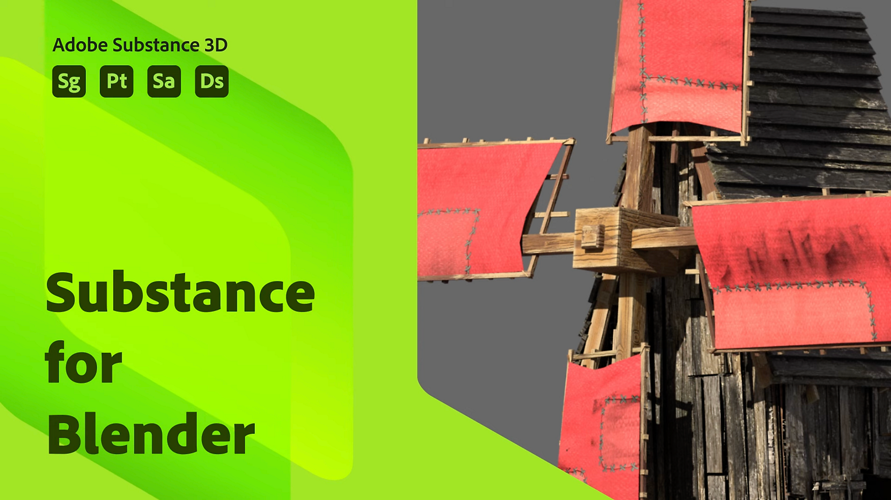

# Blender

## Sumário

* [Substance na visão geral do Blender](../../3d-applications/blender/in-blender-overview/substance-in-blender-overview.md)
* [Baixando e instalando o plug-in](../../3d-applications/blender/downloading-and-ins/downloading-and-installing-the-plugin.md)
* [Preferências](../../3d-applications/blender/preferences/preferences.md)
* [O painel Substance 3D](../../3d-applications/blender/the-3d-panel/the-substance-3d-panel.md)
* [Atalhos e navegação](../../3d-applications/blender/shortcuts-and-navigation/shortcuts-and-navigation.md)
* [Fluxos de trabalhos](../../3d-applications/blender/workflows/workflows.md)
* [Tamanho físico no Blender](../../3d-applications/blender/physical-size-in-blender/physical-size-in-blender.md)
* [Biblioteca do Substance 3D Assets](../../3d-applications/blender/3d-assets-library/substance-3d-assets-library.md)
* [Solução de problemas](../../3d-applications/blender/troubleshooting/troubleshooting.md)
* [Desinstalando o complemento](../../3d-applications/blender/uninstalling-the-add-on/uninstalling-the-add-on.md)
* [Complemento do Substance 3D para Blender Tutorials](../../3d-applications/blender/add-for-blender-tutorials/substance-3d-add-on-for-blender-tutorials.md)
* [Notas de versão](release-notes/release-notes.md)
